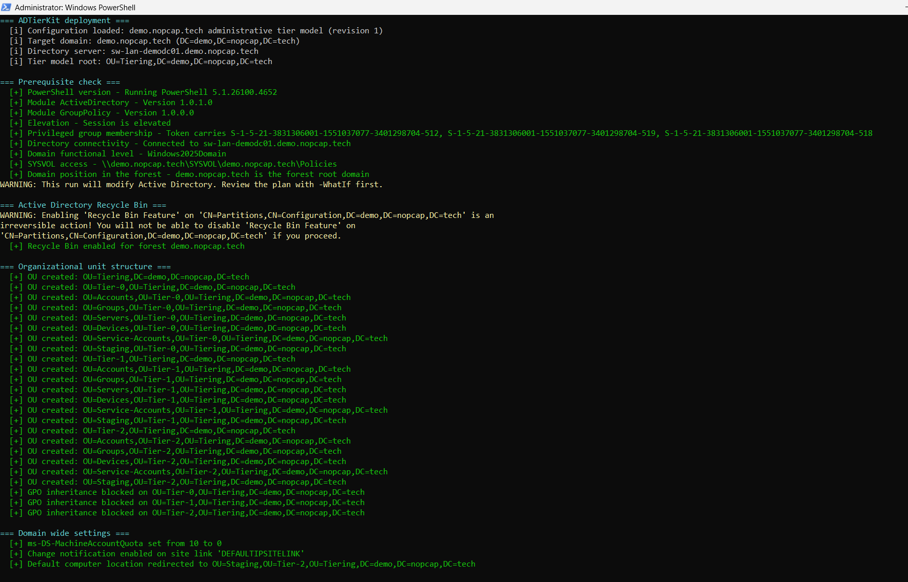

<div align="center">

# ADTierKit

Deploy, audit and maintain an Active Directory tier model from one script and one JSON file.

[](docs/GUIDE.md#prerequisites)
[](docs/GUIDE.md#prerequisites)
[](docs/GUIDE.md#limitations--notes)
[](LICENSE)

</div>

A wizard asks for your naming convention, previews every object it would create and writes
`config/tiermodel.json`. That file is the source of truth from then on. Deploy converges the
directory to it, Audit reports drift, and Sync keeps memberships current. Every mode is idempotent
and Deploy only plans unless you pass `-Apply`. It is one PowerShell script with no module and no
build step.

<div align="center">
  <a href="docs/deployment.png"></a>
</div>

> [!CAUTION]
> Logon rights are tattooed: disabling a GPO link does not give a removed logon right back.
> Never enable the logon restrictions on a domain controller without a second way in (console,
> another machine, DSRM). [`Repair-TierLockout.ps1`](docs/GUIDE.md#when-it-goes-wrong) is the way back.

> [!WARNING]
> ADTierKit has been run end to end against a Windows Server 2025 lab domain, never against a
> production directory. Take a system state backup of a DC before the first enforced deployment.

> [!NOTE]
> A human defined and reviewed the requirements; an AI model wrote most of the code and
> documentation. Review it before running it in production.

## What it does

- Structure: a tier OU tree, AGDLP groups, template and break-glass accounts, and delegation
  that lets each tier administer only its own branch (no `WriteDacl`, no `WriteOwner`).
- Isolation: per-tier logon restriction GPOs, a Domain Controller baseline, Kerberos
  authentication policy silos and a neutral staging OU for unclassified machines.
- Hardening: Windows LAPS (DSRM included), `MachineAccountQuota`, Recycle Bin, KDS root key,
  SACL auditing, Kerberos armoring.
- Audit: privileged group membership, object ownership, undeclared access group members,
  and attack paths into Tier 0 (DCSync rights, dangerous ACEs, editable Tier 0 GPOs, RBCD,
  Kerberoastable admins, krbtgt age).
- Upkeep: a daily sync task (optionally signed and configuration-pinned), reports that show what
  changed since the last run, and a lockout recovery script.

## Quick start

You need domain functional level 2012 R2 or later (2016+ recommended), the `ActiveDirectory` and
`GroupPolicy` modules, and an elevated session as Domain Admin.

```powershell
Get-ChildItem C:\ADTierKit -Recurse | Unblock-File
cd C:\ADTierKit

.\ADTierKit.ps1                                   # wizard: naming, preview, configuration
.\ADTierKit.ps1 -Mode Check                       # prerequisites
.\ADTierKit.ps1 -Mode Deploy                      # plan only - nothing is written

.\ADTierKit.ps1 -Mode Deploy -Apply -Stage RecycleBin,OU,Domain,Group,Nesting,Account,Delegation,Auditing
.\ADTierKit.ps1 -Mode Deploy -Apply -Stage GPO,Laps,KDS,Silo

.\ADTierKit.ps1 -Mode Audit                       # read-only drift and attack path report
.\ADTierKit.ps1 -Mode InstallTask                 # daily Sync as SYSTEM
```

To upgrade an existing configuration, run `.\Update-TierConfiguration.ps1` first, then plan a deploy.

| Mode | Writes | Purpose |
| --- | :---: | --- |
| *(none)* | yes | Interactive wizard, start here |
| `Deploy` | with `-Apply` | Converges the directory; plans by default |
| `Audit` | no | Drift, hygiene and attack path report |
| `Sync` | yes | Membership, account hygiene and silo assignment; safe to schedule |
| `InstallTask` | yes | Registers the daily Sync task |
| `Check` | no | Prerequisite check |

Exit codes and all options are in the [Guide](docs/GUIDE.md#modes).

### GUI

`ADTierKit.Gui.exe` is a WPF front end (C#, .NET 10) for the same script. It shows the exact
`ADTierKit.ps1` command line before running it, streams the output and opens the report and log
folder. Before an apply it makes you plan the same stages first. The wizard still opens in a
console window.

```powershell
dotnet publish gui\src\ADTierKit.Gui -c Release -r win-x64 -o .   # ADTierKit.Gui.exe next to ADTierKit.ps1
```

It needs the [.NET 10 Desktop Runtime](https://dotnet.microsoft.com/download/dotnet/10.0). Each CI
run also publishes the exe as a build artifact. See the [Guide](docs/GUIDE.md#graphical-front-end).

## Documentation

- [Guide](docs/GUIDE.md): full reference (what gets deployed, roles, ownership, guardrails,
  configuration, reports, troubleshooting, recovery)
- [Operator's Guide](docs/OPERATIONS.md): every setting the tool writes, day-to-day work and the
  rollout playbook
- [Changelog](CHANGELOG.md)

## License

[MIT](LICENSE)
